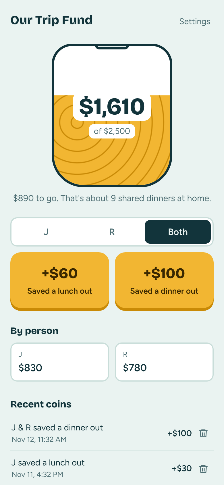
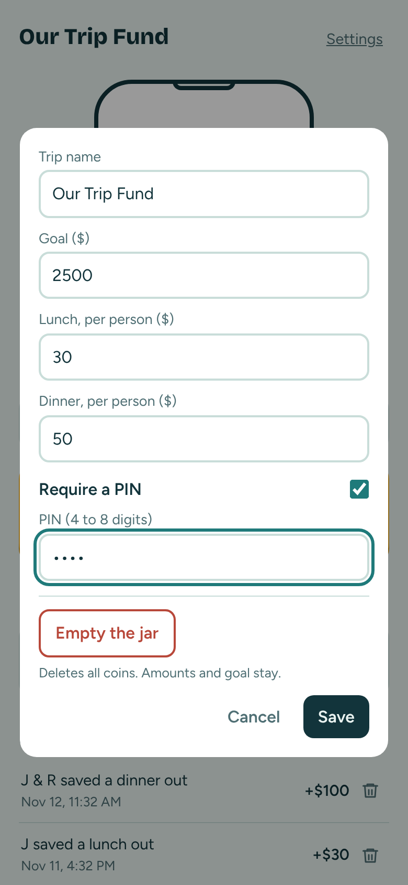
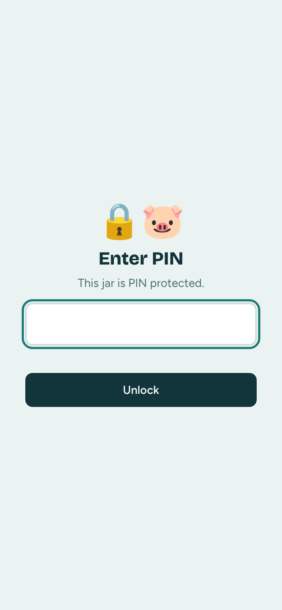
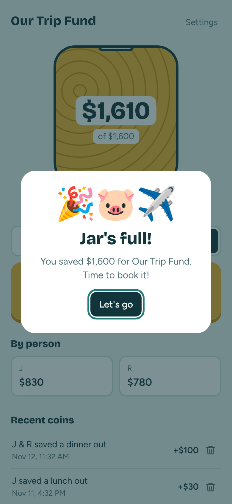

# Trip Piggybank 🐷

A shared savings jar for two people. Every time you save a meal out, tap a button and the jar fills toward your trip goal. Works as an "app" on your phone's home screen, syncs between both phones, and can be locked with a PIN.

Built with plain HTML, a Netlify Function, and Netlify Blobs (Netlify's built-in storage). No database to set up, no API keys.

<p>
  
  
  
  
</p>

## Features
- One-tap logging: pick a person (or **Both**), then tap lunch or dinner. "Both" logs double.
- Custom names: set each person's name or initials (up to 8 characters) in Settings. Renaming keeps every past coin with the right person.
- Jar fills toward the goal; per-person totals split "Both" entries evenly.
- Recent coins shows the last 10, with "Show all" and a two-tap trash icon to delete.
- Settings: trip name, the two names, goal, per-person lunch and dinner amounts, optional PIN, and "Empty the jar."
- Confetti celebration when the jar is full.
- Syncs every 10 seconds and whenever the app is reopened.

Defaults: $30 lunch, $50 dinner (per person), $2,500 goal. Change any of them in Settings.

---

## Deploy your own (about 5 minutes)

You need a free [GitHub](https://github.com) account and a free [Netlify](https://netlify.com) account.

### 1. Get the code into your GitHub
Pick one:
- **Fork:** on this repo's GitHub page, click **Fork** (top right) > **Create fork**.
- **Use as template** (if enabled): click **Use this template** > **Create a new repository**.
- **Upload:** create a new empty repo, then **Add file > Upload files** and drag in everything from this folder.

### 2. Connect it to Netlify
1. In Netlify, click **Add new project > Import an existing project**.
2. Choose **GitHub**, authorize, and pick your repo.
3. Leave the build settings as they are (they come from `netlify.toml`). Click **Deploy**.
4. In about a minute you'll get a URL like `https://random-name-123.netlify.app`. Optional: **Project configuration > Change project name** to something nicer like `our-trip-jar`.

That's it. Storage (Netlify Blobs) turns on automatically. Each Netlify site gets its own private jar, so every copy of this app has separate data.

### 3. Set it up
1. Open your URL, tap **Settings**, and set your trip name, goal, and amounts.
2. Optional: turn on **Require a PIN** (see below).
3. Send the URL (and PIN, if you set one) to your partner.

### 4. Add it to your home screen
- **iPhone:** open the URL in **Safari** > tap **Share** > **Add to Home Screen** > **Add**.
- **Android:** open in **Chrome** > tap **⋮** > **Add to Home screen** (or **Install app**).

It opens full screen with its own icon, like a regular app.

---

## PIN protection

Without a PIN, anyone who has your URL can see and add to the jar. Turn on a PIN to lock it.

**Turn it on:**
1. Tap **Settings**.
2. Switch on **Require a PIN** and enter 4 to 8 digits.
3. Tap **Save**. Your phone stays unlocked; share the PIN with your partner.


**On a new phone:** the app shows a lock screen. Enter the PIN once and that phone remembers it.


**Change the PIN:** Settings > enter a new PIN in the PIN field > Save. Leave it blank to keep the current one. Other phones will be asked for the new PIN.

**Turn it off:** Settings > switch off **Require a PIN** > Save.

**Forgot the PIN?** In Netlify, open your project > **Blobs** > store `piggybank` > delete the `jar` entry. This resets the jar completely (coins and settings), so only use it as a last resort.

The PIN is stored only as a salted hash on the server and is checked on every request, so the data can't be read or changed without it.

---

## Customize your copy

The two people's names are set in the app: tap **Settings** and fill in **Person 1** and **Person 2** (up to 8 characters each; leave blank for the defaults "J" and "R"). They sync to both phones.

Code tweaks (commit on GitHub and Netlify redeploys in under a minute):
- **Default amounts and goal:** `DEFAULTS` in `public/index.html` (only used until you save Settings).
- **App name on the home screen:** `name` and `short_name` in `public/manifest.json`, plus `apple-mobile-web-app-title` in `index.html`.
- **Icon:** replace `public/icon-192.png`, `icon-512.png`, and `apple-touch-icon.png` (same sizes).
- **Colors:** the CSS variables at the top of `index.html`.

---

## How it works

```
public/
  index.html            the whole app (UI + sync)
  manifest.json         home-screen app settings
  *.png                 icons
netlify/functions/
  jar.mjs               API at /api/jar, stores data in Netlify Blobs
netlify.toml            tells Netlify where things are
package.json            one dependency: @netlify/blobs
```

- `GET /api/jar` returns the settings and coins.
- `POST /api/jar` adds a coin, deletes one, or saves settings.
- Everything lives in a single Blobs entry. Writes use conditional updates, so two phones tapping at the same moment don't overwrite each other.

**Cost:** fits comfortably in Netlify's free tier for two people.

**Run locally (optional):** `npm install -g netlify-cli`, then `netlify dev` in this folder.
